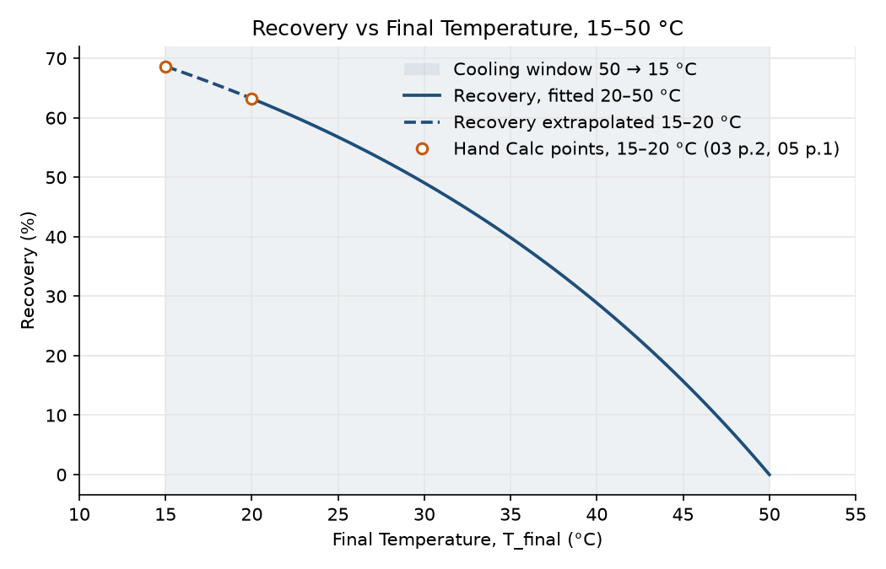

# crystal-batch

Crystallisation is a defining step in the production of paracetamol and small molecule APIs. How a solute is crystallised determines
yield, particle size, purity and therefore dissolution rate. 

**Current Capabilities**: This system is a Batch API Crystallisation Model, which calculates the mass-balance and recovery as a function
of final temperature, accounting for mother-liquor losses.

**What's Next**: Energy balance and jacket duty; three cooling profiles (linear, natural, cubic); slurry line sizing with a velocity window; GMP-style 
batch records modelled on pharmaceutical procedure.

Paracetamol is chosen for this model due to paracetamol's aqueous solubility being well documented, and thus the model can be validated against independent published data.


## Batch basis

| | |
|---|---|
| System | Paracetamol in water, seeded cooling crystallisation |
| Cooling window | 50 → 15 °C |
| Vessel | 500 L, 70% fill, ~350 kg water |
| Product per batch | 8.26 kg (theoretical equilibrium yield) |
| Recovery | ~69%, with ~3.8 kg per batch remaining in mother liquor |

Full design basis, assumptions and non-goals: [docs/BatchBasis.md](docs/BatchBasis.md)

## Results



Recovery starts at 0% at 50 °C, climbs to 68.6% at 15°C.
- Curve flattens: Final temperatures of 50->40°C give ~28 percentage points of recovery, whereas the last 5°C (20->15), produces ~5.4 points and requires chilled water to reach, thus the cooling window concludes at 15°C.

## Data sources

- **Fujiwara et al. (2002)**, *Crystal Growth & Design*: primary solubility correlation
- **Granberg & Rasmuson (1999)**, *J. Chem. Eng. Data*: independent validation

Full citations: [sources/README.md](sources/README.md)

## Validation

Fujiwara's and Granberg's data were used as a cross-check of solubility, with results agreeing within ~2% over 15-30°C, with a systematic slope difference Fujiwara's values falling increasingly  below Granberg's on cooling from +0.8% at 30°C to -1.7% at 15°C, and the curves cross near 27°C.

Mass balance hand calculations were reproduced in code, matching to within 0.1% of the scanned hand calculations. Using pytest, 18 tests pass for solubility and mass balance checks.

The apparent enthalpy of solution, derived from the correlation via van 't Hoff (ΔH=R(-A+BT)), gives 24.05 kJ/mol at 298.15K, matching Fujiwara's published value.

Workings: [validation/](validation/)

## Status

Done:
- Solubility + mass balance + yield curve (Build 3)

Next up:
- Energy balance (hand calcs done), coded in Build 4

## How to Run
**For Windows**

```
python -m venv .venv
.venv\Scripts\activate
pip install -r requirements.txt
pytest
python scripts/plot_yield.py
```

**Linux/macOS**
On Linux/macOS, replace the activate line with:

```
source .venv/bin/activate
```


